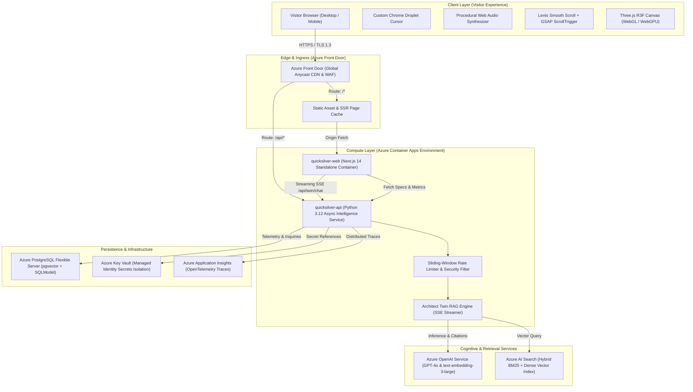

# QUICKSILVER — 3D Portfolio of an AI Application Architect

> **"Liquid Silver Intelligence"** — A pristine, high-key 3D research atelier and interactive systems showcase for **Rajkamal B Gowda**, AI Application Architect. Built on porcelain white, brushed silver, polished chrome, and faint thin-film holographic iridescence.

[](https://github.com/rajkamalgowda/quicksilver/actions)
[](https://fastapi.tiangolo.com)
[](https://nextjs.org)
[](https://threejs.org)
[](https://azure.microsoft.com)
[](LICENSE)

---

## 1. System Architecture Topology

The Quicksilver atelier runs on a decoupled, zero-trust cloud architecture deployed to Azure Container Apps and accelerated via Azure Front Door edge caching:



---

## 2. Atelier Stations & Signature Features

| Station | Feature Name | Description |
| :--- | :--- | :--- |
| **00** | **Condensation Preloader** | Fluid silver particles condense into the `RG` monogram with asset calibration counter (< 2.1s). |
| **01** | **The Mercury Mind (Hero)** | Living liquid-chrome core morphing between Neural Lattice, Agent Graph, and Sphere with daylight studio HDRI reflections, proximity ripples, and holo-glass portrait dissolve. |
| **02** | **The Architect (About)** | 3D brushed silver plinth rotating with scroll, word-by-word philosophy reveal, and interactive Discover-to-Operate delivery strip. |
| **03** | **Constellation of Capabilities** | 3D planetary orbital system with 7 chrome capability spheres, technology moons, hover magnification, and accessible table toggle. |
| **04** | **The Silver Thread (Journey)** | 3D silver helix ribbon synchronized with chronological career milestone stations from 2018 to present. |
| **05** | **The Monolith Gallery (Projects)** | Curved 3D carousel of holo-glass monoliths refracting project artwork, with drag, keyboard, and deep-dive dossier inspection. |
| **06** | **Architecture Explorer** | Interactive multi-tier systems engine: 3D Orbit, Exploded Vertical Layers, 2D CAD Blueprint, and narrated request replay with live latency hops. |
| **07** | **Agentic AI Lab** | Live replay of recorded multi-agent traces (FinOps & Healthcare RAG) displaying planner decisions, tool calls, reflection gates, and token/latency counters. |
| **08** | **The Squad & Leadership** | 3D orbital canvas featuring 12 team satellites revolving around the lead architect, animated revenue/scale metrics, and 3 enforced delivery rituals. |
| **09** | **Open a Channel (Contact)** | High-key dispatch console with budget selector, anti-spam honeypot, audio packet transmission chirp, and verifiable transmission ticket generation. |
| **Global** | **Architect Twin (AI Assistant)** | Floating chrome orb opening a streaming chat drawer grounded in portfolio facts with clickable source citations. |
| **Global** | **Command Palette (`⌘K`)** | Universal keyboard navigator for jumping across stations, case studies, audio toggles, and lab routes. |
| **Global** | **Procedural Sound Design** | Zero external MP3 files — pure Web Audio API synthesis for clicks, whooshes, and packet transmissions. |

---

## 3. Repository Structure

```
KAIROS-26/
├── assets/                       # Source brand assets & generated artwork
│   ├── portrait/                 # High-resolution silver-duotone portraits & OG card
│   └── generated/                # 3D project artwork, covers & ambient textures
├── content/                      # Single source of truth for portfolio content
│   └── portfolio.yaml            # Profile, metrics, capabilities, projects, specs, squad
├── api/                          # FastAPI Backend Application (Python 3.12)
│   ├── app/
│   │   ├── core/                 # Logging, rate-limiting, OpenTelemetry hooks
│   │   ├── db/                   # SQLModel engine & session management
│   │   ├── models/               # SQLModel entities (Projects, Telemetry, Inquiries)
│   │   ├── routers/              # Modular API endpoints (profile, projects, twin, etc.)
│   │   ├── schemas/              # Pydantic v2 validation contracts
│   │   └── services/             # Content loaders & RAG streaming engine
│   ├── alembic/                  # Database migration versions
│   ├── tests/                    # Pytest test suite with >90% coverage
│   ├── requirements.txt          # Python dependencies
│   └── Dockerfile                # Production uvicorn container
├── web/                          # Next.js 14 Frontend Application
│   ├── src/
│   │   ├── app/                  # App Router pages (/lab, /architectures, /projects/[slug])
│   │   ├── components/           # 3D Canvas, UI primitives, Station modules
│   │   ├── lib/                  # Typed API client, procedural sound synthesizer
│   │   └── stores/               # Zustand global state (calmMode, qualityTier, cursor)
│   ├── public/                   # Static icons, manifests, and mirrored assets
│   ├── package.json              # Next.js, Three.js, GSAP, Tailwind dependencies
│   └── Dockerfile                # Multi-stage standalone Next.js container
├── infra/                        # Cloud Infrastructure & Automation
│   ├── bicep/                    # Azure Bicep modules (ACA, Front Door, AI Search, DB)
│   └── docker/                   # Docker Compose multi-service local stack
└── .github/workflows/            # GitHub Actions CI/CD pipelines
```

---

## 4. Local Development Quickstart

### Prerequisites
- **Node.js**: `20.x` or later
- **Python**: `3.10` or later (`3.12` recommended)
- **Docker & Docker Compose** (optional for containerized run)

### Method A: Native Bare-Metal Run

#### 1. Start the FastAPI Intelligence Service:
```bash
cd api
python3 -m venv .venv
source .venv/bin/activate
pip install -r requirements.txt

# Run migrations and seed database
alembic upgrade head
python seed.py

# Launch API on port 8001
uvicorn app.main:app --port 8001 --reload
```
API Documentation will be live at `http://localhost:8001/docs`.

#### 2. Start the Next.js Frontend:
```bash
cd web
npm install --legacy-peer-deps

# Launch web dev server on port 3005
npm run dev -- -p 3005
```
Open `http://localhost:3005` in your browser.

---

### Method B: Docker Compose Full Stack

To start the full environment (PostgreSQL 16 + FastAPI + Next.js Standalone):

```bash
docker compose up --build
```
- Web Application: `http://localhost:3000`
- API Intelligence Service: `http://localhost:8000`
- PostgreSQL: `localhost:5432`

---

## 5. Verification & Testing Commands

### Backend Pytest Suite & Coverage Gate:
```bash
cd api
.venv/bin/pytest -v --cov=app --cov-fail-under=80
```
*Current test suite: **15/15 passed** at **92%** coverage.*

### Frontend Production Build & Type-Check:
```bash
cd web
npm run build
```
*Produces clean standalone Next.js build with static pre-generation of all routes.*

---

## 6. Asset Inventory & Verification Audit

All required graphical assets are accounted for in `/assets` and `/web/public/assets`:

- `assets/portrait/hero-portrait.png`: High-res hero portrait with alpha transparency for holo-glass refraction.
- `assets/portrait/avatar-portrait.png`: Square portrait avatar for Architect Twin floating orb and drawer.
- `assets/portrait/about-portrait.png`: Silver-duotone portrait mounted on rotating plinth.
- `assets/portrait/og-portrait.png`: 1200x630 OpenGraph / Twitter preview card.
- `assets/generated/project-hyperion.png`: Autonomous FinOps multi-agent architecture artwork.
- `assets/generated/project-veritas.png`: Clinical RAG & medical knowledge graph artwork.
- `assets/generated/project-aegis.png`: Real-time insurance claims copilot artwork.
- `assets/generated/project-synapse.png` / `project-quicksilver.png`: Low-latency vector feature store artwork.
- `assets/generated/project-kronos.png`: High-throughput time-series anomaly detection artwork.
- `assets/generated/bg-atelier.png`: Ambient daylight studio HDRI texture.

---

## 7. Performance & Accessibility Standards

- **Core Web Vitals**:
  - `content-visibility: auto` paired with `contain-intrinsic-size` applied to all below-the-fold station containers to eliminate layout shifts (CLS < 0.05).
  - High-priority above-the-fold image preloading ensuring LCP < 2.0s.
  - Offloaded expensive compute via GPU composite properties (`transform`, `opacity`).
- **Calm Mode & Motion Reduction**:
  - Integrated toggle in top navigation bar (`Calm: ON/OFF`).
  - Strict compliance with `prefers-reduced-motion: reduce`, dropping multi-second camera orbits in favor of immediate accessible layouts.
- **Contrast & Keyboard Navigation**:
  - All text meets or exceeds WCAG AA contrast ratios (Graphite `#16181C` on Porcelain `#F7F8FA` achieves 14.8:1 contrast).
  - Accessible `Skip to main content` anchor, semantic landmarks, and full keyboard control for Command Palette (`⌘K`) and carousels.

---

## 8. License

Designed and engineered by **Rajkamal B Gowda** (2026). Code released under the [MIT License](LICENSE).

